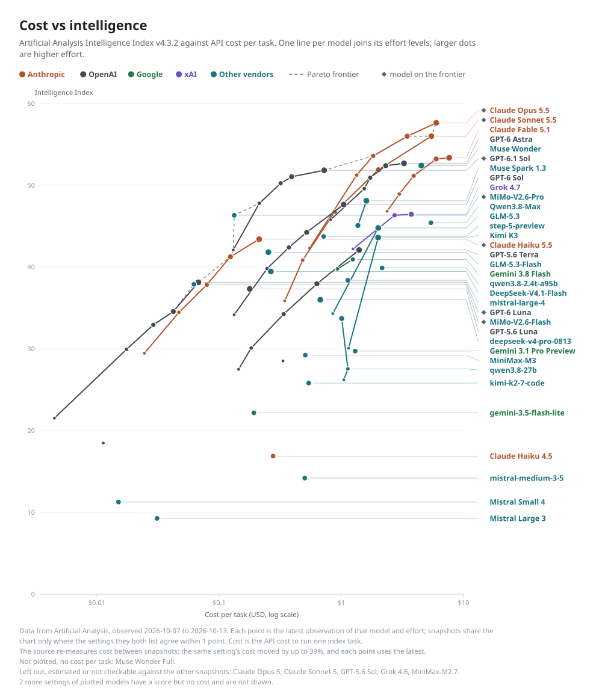
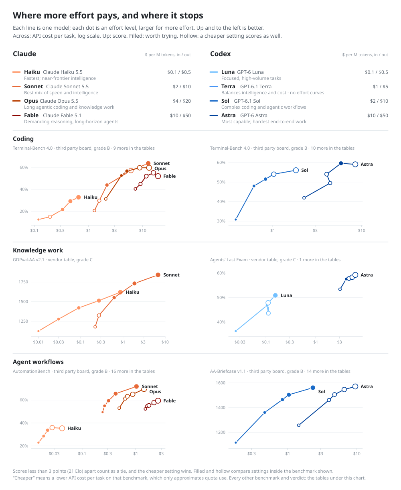
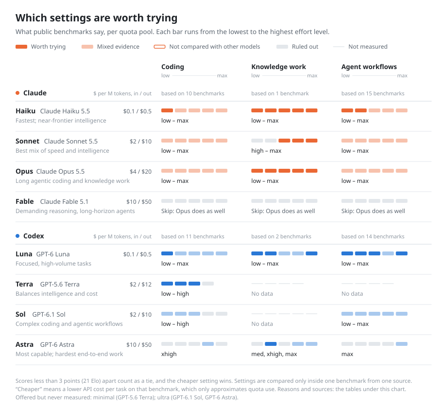

# Data pack: `model-catalog`

Versioned **pricing** and **source-backed quality/effort** facts for coding-agent model choice.

Not a CLI. Not a skill. Just versioned, **schema-validated** JSON with a **provenance registry**.

## Choosing a model and an effort level

Public benchmarks measure other people's tasks, so use them to narrow the choice. A setting is ruled out when another setting in the same quota pool costs less and scores as well. The chart shows where more effort pays and where it stops.

<!-- option-map:begin -->
<!-- Generated by scripts/render_model_catalog_charts.py. Edit guide.json or the data, not this block. -->

<picture>
  <source media="(prefers-color-scheme: dark)" srcset="charts/cost-vs-intelligence-dark.svg">
  
</picture>

**Reading the chart.** Up is smarter, left is cheaper. The frontier (dashed) holds the settings that no other setting beats on both cost and score: GPT-6 Luna low to medium (9.7–18.3 at $0.0051–$0.042), Claude Haiku 5.5 low (18.6 at $0.044), GPT-6.1 Terra low (29.2 at $0.071), Claude Haiku 5.5 high (29.6 at $0.16), GPT-6.1 Sol low (34.5 at $0.16), GPT-6.1 Terra medium to high (38.1–42.3 at $0.17–$0.26), GPT-6.1 Sol medium to max (46.1–54.5 at $0.36–$1.27), GPT-6 Astra high to xhigh (54.8–55.3 at $3.24–$3.66), Claude Opus 5.5 xhigh to max (57.0–58.4 at $6.05–$10.04). The top score is Claude Opus 5.5 max at 58.4 for $10.04 per task. Data from Artificial Analysis, observed 2026-10-28. Each point is the latest observation of that model and effort; snapshots share the chart only where the settings they both list agree within 1 point. Cost is the API cost to run one index task. Not plotted, no cost per task: Muse Wonder Full. 1 more setting of plotted models has a score but no cost and is not drawn. Below 25 on the index, so only in the all-models chart: gemini-3.5-flash-lite.

<details><summary><b>All 23 models</b> on the same axes</summary>

<picture>
  <source media="(prefers-color-scheme: dark)" srcset="charts/cost-vs-intelligence-all-dark.svg">
  
</picture>

</details>

<details><summary><b>Data behind the chart</b>: 61 settings, one row per model and effort</summary>

| Model | Effort | Intelligence Index | $/task | Observed | Note |
|---|---|---|---|---|---|
| Claude Opus 5.5 | low | 34.5 | $0.98 | 2026-10-28 |  |
| Claude Opus 5.5 | medium | 48.1 | $2.45 | 2026-10-28 |  |
| Claude Opus 5.5 | high | 51.7 | $3.46 | 2026-10-28 |  |
| Claude Opus 5.5 | xhigh | 57.0 | $6.05 | 2026-10-28 | on the frontier |
| Claude Opus 5.5 | max | 58.4 | $10.04 | 2026-10-28 | on the frontier |
| GPT-6 Astra | low | 43.0 | $1.42 | 2026-10-28 |  |
| GPT-6 Astra | medium | 51.5 | $2.73 | 2026-10-28 |  |
| GPT-6 Astra | high | 54.8 | $3.24 | 2026-10-28 | on the frontier |
| GPT-6 Astra | xhigh | 55.3 | $3.66 | 2026-10-28 | on the frontier |
| GPT-6 Astra | max | 56.9 | $6.24 | 2026-10-28 |  |
| GPT-6.1 Sol | low | 34.5 | $0.16 | 2026-10-28 | on the frontier |
| GPT-6.1 Sol | medium | 46.1 | $0.36 | 2026-10-28 | on the frontier |
| GPT-6.1 Sol | high | 50.2 | $0.59 | 2026-10-28 | on the frontier |
| GPT-6.1 Sol | xhigh | 52.3 | $0.76 | 2026-10-28 | on the frontier |
| GPT-6.1 Sol | max | 54.5 | $1.27 | 2026-10-28 | on the frontier |
| Claude Sonnet 5.5 | low | 25.3 | $0.51 | 2026-10-28 |  |
| Claude Sonnet 5.5 | medium | 30.3 | $0.78 | 2026-10-28 |  |
| Claude Sonnet 5.5 | high | 41.1 | $1.64 | 2026-10-28 |  |
| Claude Sonnet 5.5 | xhigh | 49.6 | $4.09 | 2026-10-28 |  |
| Claude Sonnet 5.5 | max | 54.2 | $10.02 | 2026-10-28 |  |
| GPT-6.1 Terra | none | 30.4 | $0.23 | 2026-10-28 |  |
| GPT-6.1 Terra | low | 29.2 | $0.071 | 2026-10-28 | on the frontier |
| GPT-6.1 Terra | medium | 38.1 | $0.17 | 2026-10-28 | on the frontier |
| GPT-6.1 Terra | high | 42.3 | $0.26 | 2026-10-28 | on the frontier |
| GPT-6.1 Terra | xhigh | 45.0 | $0.40 | 2026-10-28 |  |
| GPT-6.1 Terra | max | 51.0 | $0.96 | 2026-10-28 |  |
| Gemini 4 Argon | high | 50.4 | $7.68 | 2026-10-28 |  |
| Claude Fable 5.1 | low | 38.5 | $4.49 | 2026-10-28 |  |
| Claude Fable 5.1 | medium | 43.0 | $5.58 | 2026-10-28 |  |
| Claude Fable 5.1 | high | 47.0 | $7.56 | 2026-10-28 |  |
| Claude Fable 5.1 | xhigh | 49.7 | $10.89 | 2026-10-28 |  |
| Claude Fable 5.1 | max | 49.0 | $13.04 | 2026-10-28 |  |
| Muse Wonder | max | 43.3 | $6.95 | 2026-10-28 |  |
| Muse Spark 1.3 | max | 36.4 | $2.39 | 2026-10-28 |  |
| Claude Haiku 5.5 | low | 18.6 | $0.044 | 2026-10-28 | on the frontier |
| Claude Haiku 5.5 | medium | 24.6 | $0.092 | 2026-10-28 |  |
| Claude Haiku 5.5 | high | 29.6 | $0.16 | 2026-10-28 | on the frontier |
| Claude Haiku 5.5 | xhigh | 34.3 | $0.25 | 2026-10-28 |  |
| Claude Haiku 5.5 | max | 36.2 | $0.41 | 2026-10-28 |  |
| Grok 4.7 | low | 30.9 | $2.92 | 2026-10-28 |  |
| Grok 4.7 | high | 35.0 | $6.18 | 2026-10-28 |  |
| Grok 4.7 | xhigh | 34.3 | $7.51 | 2026-10-28 |  |
| DeepSeek-V4.1-Flash | max | 32.5 | $0.60 | 2026-10-28 |  |
| GLM-5.3 | low | 23.1 | $1.57 | 2026-10-28 |  |
| GLM-5.3 | max | 31.7 | $5.01 | 2026-10-28 |  |
| Gemini 3.8 Flash | medium | 30.0 | $6.26 | 2026-10-28 |  |
| Gemini 3.8 Flash | high | 30.5 | $7.77 | 2026-10-28 |  |
| MiMo-V2.6-Pro | unknown | 29.9 | $0.26 | 2026-10-28 |  |
| step-5-preview | unknown | 28.5 | $2.35 | 2026-10-28 |  |
| GPT-6 Luna | none | 9.4 | $0.071 | 2026-10-28 |  |
| GPT-6 Luna | low | 9.7 | $0.0051 | 2026-10-28 | on the frontier |
| GPT-6 Luna | medium | 18.3 | $0.042 | 2026-10-28 | on the frontier |
| GPT-6 Luna | high | 21.4 | $0.073 | 2026-10-28 |  |
| GPT-6 Luna | xhigh | 23.3 | $0.10 | 2026-10-28 |  |
| GPT-6 Luna | max | 27.8 | $0.15 | 2026-10-28 |  |
| MiMo-V2.6-Flash | unknown | 26.7 | $0.13 | 2026-10-28 |  |
| mistral-large-4 | unknown | 25.3 | $5.54 | 2026-10-28 |  |
| deepseek-v4-pro-0813 | max | 23.1 | $1.77 | 2026-10-28 |  |
| qwen3.8-27b | xhigh | 20.1 | $3.53 | 2026-10-28 |  |
| MiniMax-M3 | unknown | 18.7 | $1.29 | 2026-10-28 |  |
| gemini-3.5-flash-lite | high | 11.7 | $0.69 | 2026-10-28 |  |

–: the model has no effort setting, or the source does not name one.

</details>

<picture>
  <source media="(prefers-color-scheme: dark)" srcset="charts/effort-curves-dark.svg">
  
</picture>

<details><summary><b>Verdicts across all benchmarks</b>, not only the one charted above</summary>

<picture>
  <source media="(prefers-color-scheme: dark)" srcset="charts/option-map-dark.svg">
  
</picture>

<details><summary><b>Claude</b>: the reason behind each cell</summary>

| Task | Model | low | medium | high | xhigh | max |
|---|---|---|---|---|---|---|
| Coding | Claude Haiku 5.5 | ● | ◐ low (4 of 5) | ◐ Claude Sonnet 5.5 medium (2 of 6) | ◐ Claude Sonnet 5.5 medium (2 of 6) | ◐ Claude Sonnet 5.5 high (2 of 6) |
| Coding | Claude Sonnet 5.5 | ◐ Claude Haiku 5.5 xhigh (4 of 6) | ◐ Claude Haiku 5.5 xhigh (4 of 6) | ◐ medium (2 of 11) | ◐ Claude Opus 5.5 high (3 of 5) | ◐ Claude Opus 5.5 max (4 of 14) |
| Coding | Claude Opus 5.5 | ◐ Claude Sonnet 5.5 xhigh (2 of 7) | ◐ low (2 of 10) | ◐ medium (3 of 9) | ◐ high (6 of 8) | ◐ xhigh (6 of 8) |
| Coding | Claude Fable 5.1 | ✕ Claude Opus 5.5 medium (5 of 5) | ✕ Claude Opus 5.5 medium (5 of 5) | ✕ Claude Opus 5.5 medium (5 of 5) | ✕ Claude Opus 5.5 medium (5 of 5) | ✕ Claude Opus 5.5 high (6 of 6) |
| Knowledge work | Claude Haiku 5.5 | ● | ● | ● | ● | ● |
| Knowledge work | Claude Sonnet 5.5 | ✕ Claude Haiku 5.5 medium (1 of 1) | ✕ Claude Haiku 5.5 high (1 of 1) | ● | ● | ● |
| Knowledge work | Claude Opus 5.5 | ● | ● | ● | ● | ● |
| Knowledge work | Claude Fable 5.1 | ✕ Claude Opus 5.5 medium (1 of 1) | ✕ Claude Opus 5.5 medium (1 of 1) | ✕ Claude Opus 5.5 high (1 of 1) | ✕ Claude Opus 5.5 xhigh (1 of 1) | ✕ Claude Opus 5.5 xhigh (1 of 1) |
| Agent workflows | Claude Haiku 5.5 | ● | ● | ◐ medium (2 of 9) | ◐ high (4 of 9) | ◐ xhigh (4 of 9) |
| Agent workflows | Claude Sonnet 5.5 | ◐ Claude Haiku 5.5 xhigh (7 of 9) | ◐ Claude Haiku 5.5 xhigh (7 of 9) | ◐ Claude Haiku 5.5 max (3 of 9) | ◐ high (2 of 9) | ◐ xhigh (3 of 9) |
| Agent workflows | Claude Opus 5.5 | ◐ Claude Sonnet 5.5 xhigh (4 of 8) | ◐ Claude Sonnet 5.5 high (6 of 8) | ◐ medium (1 of 6) | ◐ high (3 of 6) | ◐ Claude Sonnet 5.5 max (10 of 18) |
| Agent workflows | Claude Fable 5.1 | ✕ Claude Opus 5.5 medium (5 of 5) | ✕ Claude Opus 5.5 medium (5 of 5) | ✕ Claude Opus 5.5 high (5 of 5) | ✕ Claude Opus 5.5 xhigh (5 of 5) | ✕ Claude Opus 5.5 xhigh (5 of 5) |

✕ *model effort (n of n)*: that cheaper setting scores as well on every benchmark they share. ← *effort*: the same, for a lower effort of this model. ◐ *(k of n)*: cheaper and as good on k of the n benchmarks they share. ○: not yet compared with other models.

| Task | Benchmark | Source | Grade | Models compared |
|---|---|---|---|---|
| Coding | CursorBench 3.2.0 | [`performance/anthropic-fable-mythos-5-1-2026-09.json`](performance/anthropic-fable-mythos-5-1-2026-09.json) · vendor table | C | Claude Fable 5.1 |
| Coding | CursorBench 4.0 | [`performance/anthropic-opus-5-5-system-card-2026-09.json`](performance/anthropic-opus-5-5-system-card-2026-09.json) · vendor table | C | Claude Fable 5.1, Claude Opus 5.5 |
| Coding | CursorBench 4.0 | [`performance/anthropic-sonnet5-5-digitized-2026-09.json`](performance/anthropic-sonnet5-5-digitized-2026-09.json) · vendor table | C | Claude Opus 5.5, Claude Sonnet 5.5 |
| Coding | CursorBench 4.0 | [`performance/anthropic-opus5-5-digitized-2026-09.json`](performance/anthropic-opus5-5-digitized-2026-09.json) · vendor table | C | Claude Fable 5.1, Claude Opus 5.5 |
| Coding | FrontierCode v1.1 (Main) | [`performance/anthropic-sonnet5-5-digitized-2026-09.json`](performance/anthropic-sonnet5-5-digitized-2026-09.json) · vendor table | C | Claude Opus 5.5, Claude Sonnet 5.5 |
| Coding | FrontierCode v1.1 (Main) | [`performance/anthropic-opus5-5-digitized-2026-09.json`](performance/anthropic-opus5-5-digitized-2026-09.json) · vendor table | C | Claude Fable 5.1, Claude Opus 5.5 |
| Coding | FrontierCode v1.1 (Main) | [`performance/openai-gpt-6-sol-luna-launch-curves-2026-09.json`](performance/openai-gpt-6-sol-luna-launch-curves-2026-09.json) · vendor table | C | Claude Fable 5.1 |
| Coding | SciCode | [`performance/artificial-analysis-claude-haiku-5-5-2026-10-07.json`](performance/artificial-analysis-claude-haiku-5-5-2026-10-07.json) · third party board | B | Claude Haiku 5.5, Claude Opus 5.5, Claude Sonnet 5.5 |
| Coding | SciCode | [`performance/artificial-analysis-gemini-4-argon-2026-10-13.json`](performance/artificial-analysis-gemini-4-argon-2026-10-13.json) · third party board | B | Claude Fable 5.1, Claude Haiku 5.5, Claude Opus 5.5, Claude Sonnet 5.5 |
| Coding | Terminal-Bench 4.0 | [`performance/anthropic-fable-mythos-5-1-2026-09.json`](performance/anthropic-fable-mythos-5-1-2026-09.json) · vendor table | C | Claude Fable 5.1 |
| Coding | Terminal-Bench 4.0 | [`performance/anthropic-haiku5-5-digitized-2026-10.json`](performance/anthropic-haiku5-5-digitized-2026-10.json) · vendor table | C | Claude Haiku 5.5, Claude Sonnet 5.5 |
| Coding | Terminal-Bench 4.0 | [`performance/anthropic-sonnet5-5-digitized-2026-09.json`](performance/anthropic-sonnet5-5-digitized-2026-09.json) · vendor table | C | Claude Opus 5.5, Claude Sonnet 5.5 |
| Coding | Terminal-Bench 4.0 | [`performance/artificial-analysis-claude-haiku-5-5-2026-10-07.json`](performance/artificial-analysis-claude-haiku-5-5-2026-10-07.json) · third party board | B | Claude Haiku 5.5, Claude Opus 5.5, Claude Sonnet 5.5 |
| Coding | Terminal-Bench 4.0 | [`performance/artificial-analysis-gemini-4-argon-2026-10-13.json`](performance/artificial-analysis-gemini-4-argon-2026-10-13.json) · third party board | B | Claude Fable 5.1, Claude Haiku 5.5, Claude Opus 5.5, Claude Sonnet 5.5 |
| Coding | Terminal-Bench 4.0 | [`performance/anthropic-opus5-5-digitized-2026-09.json`](performance/anthropic-opus5-5-digitized-2026-09.json) · vendor table | C | Claude Fable 5.1, Claude Opus 5.5 |
| Coding | Terminal-Bench 4.0 | [`performance/terminal-bench-4-vals-opus-5-5-2026-09.json`](performance/terminal-bench-4-vals-opus-5-5-2026-09.json) · other | C | Claude Fable 5.1, Claude Opus 5.5 |
| Coding | Terminal-Bench 4.0 | [`performance/third-party-board-roster-refresh-2026-10-07.json`](performance/third-party-board-roster-refresh-2026-10-07.json) · third party board | B | Claude Fable 5.1, Claude Opus 5.5, Claude Sonnet 5.5 |
| Coding | Terminal-Bench 4.0 | [`performance/vals-ai-gemini-4-argon-2026-10-13.json`](performance/vals-ai-gemini-4-argon-2026-10-13.json) · third party board | B | Claude Fable 5.1, Claude Haiku 5.5, Claude Opus 5.5, Claude Sonnet 5.5 |
| Coding | Code Migration (Vals AI) | [`performance/vals-ai-gemini-4-argon-2026-10-13.json`](performance/vals-ai-gemini-4-argon-2026-10-13.json) · third party board | B | Claude Fable 5.1, Claude Haiku 5.5, Claude Opus 5.5, Claude Sonnet 5.5 |
| Coding | IOI (Vals AI) | [`performance/vals-ai-gemini-4-argon-2026-10-13.json`](performance/vals-ai-gemini-4-argon-2026-10-13.json) · third party board | B | Claude Fable 5.1, Claude Haiku 5.5, Claude Opus 5.5, Claude Sonnet 5.5 |
| Coding | ProgramBench (Vals AI) | [`performance/vals-ai-gemini-4-argon-2026-10-13.json`](performance/vals-ai-gemini-4-argon-2026-10-13.json) · third party board | B | Claude Fable 5.1, Claude Haiku 5.5, Claude Opus 5.5, Claude Sonnet 5.5 |
| Coding | SWE-bench Multimodal (Vals AI) | [`performance/vals-ai-gemini-4-argon-2026-10-13.json`](performance/vals-ai-gemini-4-argon-2026-10-13.json) · third party board | B | Claude Fable 5.1, Claude Haiku 5.5, Claude Opus 5.5, Claude Sonnet 5.5 |
| Coding | Vibe Code Bench v1.1 (Vals AI) | [`performance/vals-ai-gemini-4-argon-2026-10-13.json`](performance/vals-ai-gemini-4-argon-2026-10-13.json) · third party board | B | Claude Fable 5.1, Claude Haiku 5.5, Claude Opus 5.5, Claude Sonnet 5.5 |
| Knowledge work | GDPval-AA v2.1 | [`performance/anthropic-haiku5-5-digitized-2026-10.json`](performance/anthropic-haiku5-5-digitized-2026-10.json) · vendor table | C | Claude Haiku 5.5, Claude Sonnet 5.5 |
| Knowledge work | GDPval-AA v2.1 | [`performance/anthropic-opus5-5-digitized-2026-09.json`](performance/anthropic-opus5-5-digitized-2026-09.json) · vendor table | C | Claude Fable 5.1, Claude Opus 5.5 |
| Agent workflows | AA-Briefcase v1.1 | [`performance/artificial-analysis-claude-haiku-5-5-2026-10-07.json`](performance/artificial-analysis-claude-haiku-5-5-2026-10-07.json) · third party board | B | Claude Haiku 5.5, Claude Opus 5.5, Claude Sonnet 5.5 |
| Agent workflows | AA-Briefcase v1.1 | [`performance/artificial-analysis-gemini-4-argon-2026-10-13.json`](performance/artificial-analysis-gemini-4-argon-2026-10-13.json) · third party board | B | Claude Fable 5.1, Claude Haiku 5.5, Claude Opus 5.5, Claude Sonnet 5.5 |
| Agent workflows | AutomationBench | [`performance/artificial-analysis-claude-haiku-5-5-2026-10-07.json`](performance/artificial-analysis-claude-haiku-5-5-2026-10-07.json) · third party board | B | Claude Haiku 5.5, Claude Opus 5.5, Claude Sonnet 5.5 |
| Agent workflows | AutomationBench | [`performance/artificial-analysis-gemini-4-argon-2026-10-13.json`](performance/artificial-analysis-gemini-4-argon-2026-10-13.json) · third party board | B | Claude Fable 5.1, Claude Haiku 5.5, Claude Opus 5.5, Claude Sonnet 5.5 |
| Agent workflows | AutomationBench | [`performance/anthropic-opus5-5-digitized-2026-09.json`](performance/anthropic-opus5-5-digitized-2026-09.json) · vendor table | C | Claude Opus 5.5 |
| Agent workflows | BioMysteryBench | [`performance/vals-ai-gemini-4-argon-2026-10-13.json`](performance/vals-ai-gemini-4-argon-2026-10-13.json) · third party board | B | Claude Haiku 5.5, Claude Opus 5.5, Claude Sonnet 5.5 |
| Agent workflows | gdp.pdf | [`performance/artificial-analysis-claude-haiku-5-5-2026-10-07.json`](performance/artificial-analysis-claude-haiku-5-5-2026-10-07.json) · third party board | B | Claude Haiku 5.5, Claude Opus 5.5, Claude Sonnet 5.5 |
| Agent workflows | gdp.pdf | [`performance/artificial-analysis-gemini-4-argon-2026-10-13.json`](performance/artificial-analysis-gemini-4-argon-2026-10-13.json) · third party board | B | Claude Fable 5.1, Claude Haiku 5.5, Claude Opus 5.5, Claude Sonnet 5.5 |
| Agent workflows | GDPval-AA v2.1 | [`performance/artificial-analysis-claude-haiku-5-5-2026-10-07.json`](performance/artificial-analysis-claude-haiku-5-5-2026-10-07.json) · third party board | B | Claude Haiku 5.5, Claude Opus 5.5, Claude Sonnet 5.5 |
| Agent workflows | GDPval-AA v2.1 | [`performance/artificial-analysis-gemini-4-argon-2026-10-13.json`](performance/artificial-analysis-gemini-4-argon-2026-10-13.json) · third party board | B | Claude Fable 5.1, Claude Haiku 5.5, Claude Opus 5.5, Claude Sonnet 5.5 |
| Agent workflows | Harvey Legal Agent Benchmark | [`performance/vals-ai-gemini-4-argon-2026-10-13.json`](performance/vals-ai-gemini-4-argon-2026-10-13.json) · third party board | B | Claude Fable 5.1, Claude Haiku 5.5, Claude Opus 5.5, Claude Sonnet 5.5 |
| Agent workflows | OSWorld 2.1 (partial score) | [`performance/anthropic-haiku5-5-digitized-2026-10.json`](performance/anthropic-haiku5-5-digitized-2026-10.json) · vendor table | C | Claude Haiku 5.5, Claude Sonnet 5.5 |
| Agent workflows | Terminal-Bench Science 0.1 | [`performance/vals-ai-gemini-4-argon-2026-10-13.json`](performance/vals-ai-gemini-4-argon-2026-10-13.json) · third party board | B | Claude Fable 5.1, Claude Haiku 5.5, Claude Opus 5.5, Claude Sonnet 5.5 |
| Agent workflows | CyberBench v1.1 (Vals AI) | [`performance/vals-ai-gemini-4-argon-2026-10-13.json`](performance/vals-ai-gemini-4-argon-2026-10-13.json) · third party board | B | Claude Fable 5.1, Claude Haiku 5.5, Claude Opus 5.5, Claude Sonnet 5.5 |
| Agent workflows | EMB (Vals AI) | [`performance/vals-ai-gemini-4-argon-2026-10-13.json`](performance/vals-ai-gemini-4-argon-2026-10-13.json) · third party board | B | Claude Fable 5.1, Claude Haiku 5.5, Claude Opus 5.5, Claude Sonnet 5.5 |
| Agent workflows | Vals Finance Agent v2 | [`performance/vals-ai-gemini-4-argon-2026-10-13.json`](performance/vals-ai-gemini-4-argon-2026-10-13.json) · third party board | B | Claude Fable 5.1, Claude Haiku 5.5, Claude Opus 5.5, Claude Sonnet 5.5 |
| Agent workflows | Legal Research Bench (Vals AI) | [`performance/vals-ai-gemini-4-argon-2026-10-13.json`](performance/vals-ai-gemini-4-argon-2026-10-13.json) · third party board | B | Claude Fable 5.1, Claude Haiku 5.5, Claude Opus 5.5, Claude Sonnet 5.5 |
| Agent workflows | Public Benefits Bench v1.1 (Vals AI) | [`performance/vals-ai-gemini-4-argon-2026-10-13.json`](performance/vals-ai-gemini-4-argon-2026-10-13.json) · third party board | B | Claude Fable 5.1, Claude Haiku 5.5, Claude Opus 5.5, Claude Sonnet 5.5 |
| Agent workflows | SRE Bench (Vals AI) | [`performance/vals-ai-gemini-4-argon-2026-10-13.json`](performance/vals-ai-gemini-4-argon-2026-10-13.json) · third party board | B | Claude Fable 5.1, Claude Haiku 5.5, Claude Opus 5.5, Claude Sonnet 5.5 |
| Agent workflows | Tax Agent Bench (Vals AI) | [`performance/vals-ai-gemini-4-argon-2026-10-13.json`](performance/vals-ai-gemini-4-argon-2026-10-13.json) · third party board | B | Claude Fable 5.1, Claude Haiku 5.5, Claude Opus 5.5, Claude Sonnet 5.5 |
| Agent workflows | Time Horizon Index: KSP (Vals AI) | [`performance/vals-ai-gemini-4-argon-2026-10-13.json`](performance/vals-ai-gemini-4-argon-2026-10-13.json) · third party board | B | Claude Fable 5.1, Claude Opus 5.5 |
| Agent workflows | WANDR | [`performance/anthropic-opus5-5-digitized-2026-09.json`](performance/anthropic-opus5-5-digitized-2026-09.json) · vendor table | C | Claude Fable 5.1, Claude Opus 5.5 |

</details>

<details><summary><b>Codex</b>: the reason behind each cell</summary>

| Task | Model | low | medium | high | xhigh | max |
|---|---|---|---|---|---|---|
| Coding | GPT-6 Luna | ● | ◐ low (1 of 4) | ◐ medium (3 of 4) | ◐ high (3 of 4) | ◐ xhigh (1 of 4) |
| Coding | GPT-6.1 Terra | · | · | · | · | · |
| Coding | GPT-6.1 Sol | ◐ GPT-6 Luna xhigh (1 of 2) | ◐ low (2 of 4) | ◐ medium (1 of 2) | ← high (2 of 2) | ← xhigh (2 of 2) |
| Coding | GPT-6 Astra | ✕ GPT-6 Luna max (2 of 2) | ✕ GPT-6.1 Sol medium (2 of 2) | ✕ GPT-6.1 Sol high (2 of 2) | ◐ high (9 of 10) | ← xhigh (10 of 10) |
| Knowledge work | GPT-6 Luna | ● | ● | ◐ xhigh (1 of 2) | ◐ medium (1 of 2) | ● |
| Knowledge work | GPT-6.1 Terra | · | · | · | · | · |
| Knowledge work | GPT-6.1 Sol | · | · | · | · | · |
| Knowledge work | GPT-6 Astra | ✕ GPT-6 Luna max (1 of 1) | ● | ← medium (2 of 2) | ◐ medium (1 of 2) | ◐ xhigh (1 of 2) |
| Agent workflows | GPT-6 Luna | ● | ● | ● | ◐ high (5 of 7) | ● |
| Agent workflows | GPT-6.1 Terra | · | · | · | · | · |
| Agent workflows | GPT-6.1 Sol | ◐ GPT-6 Luna max (3 of 4) | ◐ GPT-6 Luna max (1 of 4) | ◐ medium (2 of 4) | ◐ high (2 of 4) | ◐ medium (4 of 8) |
| Agent workflows | GPT-6 Astra | ✕ GPT-6.1 Sol medium (4 of 4) | ✕ GPT-6.1 Sol high (4 of 4) | ✕ GPT-6.1 Sol xhigh (4 of 4) | ✕ GPT-6.1 Sol max (4 of 4) | ◐ GPT-6.1 Sol max (13 of 17) |

✕ *model effort (n of n)*: that cheaper setting scores as well on every benchmark they share. ← *effort*: the same, for a lower effort of this model. ◐ *(k of n)*: cheaper and as good on k of the n benchmarks they share. ○: not yet compared with other models.

| Task | Benchmark | Source | Grade | Models compared |
|---|---|---|---|---|
| Coding | DeepSWE Leaderboard (datacurve.ai) | [`performance/google-xai-board-snapshot-2026-09-23.json`](performance/google-xai-board-snapshot-2026-09-23.json) · third party board | B | GPT-6 Astra |
| Coding | DeepSWE v1.1 | [`performance/openai-gpt-6-astra-launch-2026-09.json`](performance/openai-gpt-6-astra-launch-2026-09.json) · vendor table | C | GPT-6 Astra |
| Coding | DeepSWE v1.1 | [`performance/openai-gpt-6-sol-luna-launch-curves-2026-09.json`](performance/openai-gpt-6-sol-luna-launch-curves-2026-09.json) · vendor table | C | GPT-6 Astra, GPT-6 Luna |
| Coding | FrontierCode 1.1 Extended | [`performance/openai-gpt-6-astra-launch-2026-09.json`](performance/openai-gpt-6-astra-launch-2026-09.json) · vendor table | C | GPT-6 Astra |
| Coding | FrontierCode v1.1 (Main) | [`performance/anthropic-opus5-5-digitized-2026-09.json`](performance/anthropic-opus5-5-digitized-2026-09.json) · vendor table | C | GPT-6 Astra |
| Coding | FrontierCode v1.1 (Main) | [`performance/openai-gpt-6-sol-luna-launch-curves-2026-09.json`](performance/openai-gpt-6-sol-luna-launch-curves-2026-09.json) · vendor table | C | GPT-6 Astra, GPT-6 Luna |
| Coding | SciCode | [`performance/artificial-analysis-claude-haiku-5-5-2026-10-07.json`](performance/artificial-analysis-claude-haiku-5-5-2026-10-07.json) · third party board | B | GPT-6 Astra, GPT-6 Luna, GPT-6.1 Sol |
| Coding | SciCode | [`performance/artificial-analysis-gemini-4-argon-2026-10-13.json`](performance/artificial-analysis-gemini-4-argon-2026-10-13.json) · third party board | B | GPT-6 Astra, GPT-6.1 Sol |
| Coding | Terminal-Bench 4.0 | [`performance/artificial-analysis-claude-haiku-5-5-2026-10-07.json`](performance/artificial-analysis-claude-haiku-5-5-2026-10-07.json) · third party board | B | GPT-6 Astra, GPT-6 Luna, GPT-6.1 Sol |
| Coding | Terminal-Bench 4.0 | [`performance/artificial-analysis-gemini-4-argon-2026-10-13.json`](performance/artificial-analysis-gemini-4-argon-2026-10-13.json) · third party board | B | GPT-6 Astra, GPT-6.1 Sol |
| Coding | Terminal-Bench 4.0 | [`performance/anthropic-opus5-5-digitized-2026-09.json`](performance/anthropic-opus5-5-digitized-2026-09.json) · vendor table | C | GPT-6 Astra |
| Coding | Terminal-Bench 4.0 | [`performance/third-party-board-roster-refresh-2026-10-07.json`](performance/third-party-board-roster-refresh-2026-10-07.json) · third party board | B | GPT-6 Astra, GPT-6 Luna, GPT-6.1 Sol |
| Coding | Terminal-Bench 4.0 | [`performance/vals-ai-gemini-4-argon-2026-10-13.json`](performance/vals-ai-gemini-4-argon-2026-10-13.json) · third party board | B | GPT-6 Astra, GPT-6.1 Sol |
| Coding | Terminal-Bench 4.0 | [`performance/openai-gpt-6-astra-launch-2026-09.json`](performance/openai-gpt-6-astra-launch-2026-09.json) · vendor table | C | GPT-6 Astra |
| Coding | Code Migration (Vals AI) | [`performance/vals-ai-gemini-4-argon-2026-10-13.json`](performance/vals-ai-gemini-4-argon-2026-10-13.json) · third party board | B | GPT-6 Astra, GPT-6.1 Sol |
| Coding | IOI (Vals AI) | [`performance/vals-ai-gemini-4-argon-2026-10-13.json`](performance/vals-ai-gemini-4-argon-2026-10-13.json) · third party board | B | GPT-6 Astra, GPT-6.1 Sol |
| Coding | ProgramBench (Vals AI) | [`performance/vals-ai-gemini-4-argon-2026-10-13.json`](performance/vals-ai-gemini-4-argon-2026-10-13.json) · third party board | B | GPT-6 Astra, GPT-6.1 Sol |
| Coding | SWE-bench Multimodal (Vals AI) | [`performance/vals-ai-gemini-4-argon-2026-10-13.json`](performance/vals-ai-gemini-4-argon-2026-10-13.json) · third party board | B | GPT-6 Astra, GPT-6.1 Sol |
| Coding | Vibe Code Bench v1.1 (Vals AI) | [`performance/vals-ai-gemini-4-argon-2026-10-13.json`](performance/vals-ai-gemini-4-argon-2026-10-13.json) · third party board | B | GPT-6 Astra, GPT-6.1 Sol |
| Knowledge work | Agents' Last Exam | [`performance/openai-gpt-6-sol-luna-launch-curves-2026-09.json`](performance/openai-gpt-6-sol-luna-launch-curves-2026-09.json) · vendor table | C | GPT-6 Astra, GPT-6 Luna |
| Knowledge work | GDPval-AA v2.1 | [`performance/anthropic-haiku5-5-digitized-2026-10.json`](performance/anthropic-haiku5-5-digitized-2026-10.json) · vendor table | C | GPT-6 Luna |
| Knowledge work | GDPval-AA v2.1 | [`performance/anthropic-opus5-5-digitized-2026-09.json`](performance/anthropic-opus5-5-digitized-2026-09.json) · vendor table | C | GPT-6 Astra |
| Agent workflows | AA-Briefcase v1.1 | [`performance/artificial-analysis-claude-haiku-5-5-2026-10-07.json`](performance/artificial-analysis-claude-haiku-5-5-2026-10-07.json) · third party board | B | GPT-6 Astra, GPT-6 Luna, GPT-6.1 Sol |
| Agent workflows | AA-Briefcase v1.1 | [`performance/artificial-analysis-gemini-4-argon-2026-10-13.json`](performance/artificial-analysis-gemini-4-argon-2026-10-13.json) · third party board | B | GPT-6 Astra, GPT-6.1 Sol |
| Agent workflows | AutomationBench | [`performance/artificial-analysis-claude-haiku-5-5-2026-10-07.json`](performance/artificial-analysis-claude-haiku-5-5-2026-10-07.json) · third party board | B | GPT-6 Astra, GPT-6 Luna, GPT-6.1 Sol |
| Agent workflows | AutomationBench | [`performance/artificial-analysis-gemini-4-argon-2026-10-13.json`](performance/artificial-analysis-gemini-4-argon-2026-10-13.json) · third party board | B | GPT-6 Astra, GPT-6.1 Sol |
| Agent workflows | AutomationBench | [`performance/anthropic-opus5-5-digitized-2026-09.json`](performance/anthropic-opus5-5-digitized-2026-09.json) · vendor table | C | GPT-6 Astra |
| Agent workflows | AutomationBench | [`performance/openai-gpt-6-sol-luna-launch-curves-2026-09.json`](performance/openai-gpt-6-sol-luna-launch-curves-2026-09.json) · vendor table | C | GPT-6 Astra, GPT-6 Luna |
| Agent workflows | BioMysteryBench | [`performance/vals-ai-gemini-4-argon-2026-10-13.json`](performance/vals-ai-gemini-4-argon-2026-10-13.json) · third party board | B | GPT-6 Astra, GPT-6.1 Sol |
| Agent workflows | gdp.pdf | [`performance/artificial-analysis-claude-haiku-5-5-2026-10-07.json`](performance/artificial-analysis-claude-haiku-5-5-2026-10-07.json) · third party board | B | GPT-6 Astra, GPT-6 Luna, GPT-6.1 Sol |
| Agent workflows | gdp.pdf | [`performance/artificial-analysis-gemini-4-argon-2026-10-13.json`](performance/artificial-analysis-gemini-4-argon-2026-10-13.json) · third party board | B | GPT-6 Astra, GPT-6.1 Sol |
| Agent workflows | GDPval-AA v2.1 | [`performance/artificial-analysis-claude-haiku-5-5-2026-10-07.json`](performance/artificial-analysis-claude-haiku-5-5-2026-10-07.json) · third party board | B | GPT-6 Astra, GPT-6 Luna, GPT-6.1 Sol |
| Agent workflows | GDPval-AA v2.1 | [`performance/artificial-analysis-gemini-4-argon-2026-10-13.json`](performance/artificial-analysis-gemini-4-argon-2026-10-13.json) · third party board | B | GPT-6 Astra, GPT-6.1 Sol |
| Agent workflows | Harvey Legal Agent Benchmark | [`performance/vals-ai-gemini-4-argon-2026-10-13.json`](performance/vals-ai-gemini-4-argon-2026-10-13.json) · third party board | B | GPT-6 Astra, GPT-6.1 Sol |
| Agent workflows | OSWorld 2.0 (partial score) | [`performance/openai-gpt-6-sol-luna-launch-curves-2026-09.json`](performance/openai-gpt-6-sol-luna-launch-curves-2026-09.json) · vendor table | C | GPT-6 Astra, GPT-6 Luna |
| Agent workflows | OSWorld 2.1 (partial score) | [`performance/anthropic-haiku5-5-digitized-2026-10.json`](performance/anthropic-haiku5-5-digitized-2026-10.json) · vendor table | C | GPT-6 Luna |
| Agent workflows | Terminal-Bench Science 0.1 | [`performance/vals-ai-gemini-4-argon-2026-10-13.json`](performance/vals-ai-gemini-4-argon-2026-10-13.json) · third party board | B | GPT-6 Astra, GPT-6.1 Sol |
| Agent workflows | CyberBench v1.1 (Vals AI) | [`performance/vals-ai-gemini-4-argon-2026-10-13.json`](performance/vals-ai-gemini-4-argon-2026-10-13.json) · third party board | B | GPT-6 Astra, GPT-6.1 Sol |
| Agent workflows | EMB (Vals AI) | [`performance/vals-ai-gemini-4-argon-2026-10-13.json`](performance/vals-ai-gemini-4-argon-2026-10-13.json) · third party board | B | GPT-6 Astra, GPT-6.1 Sol |
| Agent workflows | Vals Finance Agent v2 | [`performance/vals-ai-gemini-4-argon-2026-10-13.json`](performance/vals-ai-gemini-4-argon-2026-10-13.json) · third party board | B | GPT-6 Astra, GPT-6.1 Sol |
| Agent workflows | Legal Research Bench (Vals AI) | [`performance/vals-ai-gemini-4-argon-2026-10-13.json`](performance/vals-ai-gemini-4-argon-2026-10-13.json) · third party board | B | GPT-6 Astra, GPT-6.1 Sol |
| Agent workflows | SRE Bench (Vals AI) | [`performance/vals-ai-gemini-4-argon-2026-10-13.json`](performance/vals-ai-gemini-4-argon-2026-10-13.json) · third party board | B | GPT-6 Astra, GPT-6.1 Sol |
| Agent workflows | Tax Agent Bench (Vals AI) | [`performance/vals-ai-gemini-4-argon-2026-10-13.json`](performance/vals-ai-gemini-4-argon-2026-10-13.json) · third party board | B | GPT-6 Astra, GPT-6.1 Sol |

</details>

</details>

<!-- option-map:end -->

For the settings that are left:

- Give each role a fixed model and effort level. The [`model-choice-policy`](../model-choice-policy/) pack records these defaults (`waspflow ops list`).
- Move up an effort level or a tier when verification fails. A passing check does not prove that the cheaper setting was enough.
- Every benchmark here is a hard task. For mechanical work, such as renames and lookups, compare token prices instead.

Most of these numbers come from vendor launch charts (grade C) without error bars. Subscription quota is metered differently from the API dollars used here.

For independently run comparisons across many more models, including speed and latency, see [Artificial Analysis](https://artificialanalysis.ai/models).

## Get this pack (click / copy — no URL math)

| | |
|---|---|
| **Latest release** | [data-model-catalog releases](https://github.com/tnunamak/minnows/releases?q=data-model-catalog&expanded=true) — open the newest, hit **Assets → Download** |
| **This version** | [data-model-catalog-v0.5.17](https://github.com/tnunamak/minnows/releases/tag/data-model-catalog-v0.5.17) — published by CI on push to main |
| **All data packs** | [data/README.md](../README.md) |
| **Machine index** | [data/index.json](../index.json) on `main` |
| **Schemas** | [SCHEMA.md](SCHEMA.md) · [schemas/](schemas/) |
| **Provenance** | [SOURCES.json](SOURCES.json) — every score/rate links here |

### Full pack

```bash
TAG=data-model-catalog-v0.5.17
curl -fsSL -L \
  "https://github.com/tnunamak/minnows/releases/download/${TAG}/${TAG}.tar.gz" \
  | tar -xz

# or
./scripts/fetch-data-pack.sh model-catalog
./scripts/fetch-data-pack.sh model-catalog v0.5.16
```

### Local

```bash
export DATA_PACKS_HOME="${DATA_PACKS_HOME:-$HOME/.local/share/minnows-data}"
# after ./install.sh → $DATA_PACKS_HOME/model-catalog/pack.json
./scripts/validate_data_pack.py model-catalog
```

## Layout

| Path | Role |
|---|---|
| `pack.json` | Envelope (tag, file list, schema pointers) |
| `models.json` | **L0 model registry** — canonical ids + aliases (join key) |
| `metrics.json` | Metric registry (comparability boundary)
| `SOURCES.json` | **Provenance registry** — id → URL / publisher / kind |
| `SCHEMA.md` / `schemas/` | Contracts — pricing + performance + sources v1 |
| `pricing/*.json` | USD/MTok or Codex credits (tokensmash-compatible) |
| `performance/*.json` | Vendor + third-party scores/claims |
| `capabilities/*.json` | Effort/mode surfaces per model |
| `digitized/` | Chart extraction artifacts (case-by-case) |
| `guide.json` | Inputs for the README charts: quota pools, tiers, task families, tie rule, display labels |
| `charts/` | README effort curves and option map, light and dark SVG. Generated by `scripts/render_model_catalog_charts.py`; do not edit by hand |

### Performance documents (v0.3)

| File | What | Primary sources |
|------|------|-----------------|
| `anthropic-effort-quality-2026-07.json` | Sonnet 5 effort×cost framing | Anthropic Sonnet 5 post |
| `openai-quality-2026-07.json` | GPT-5.5 launch evals | OpenAI GPT-5.5 post |
| `openai-gpt-5-6-launch-2026-07.json` | **Full GPT-5.6 Sol/Terra/Luna tables** (coding, cyber, science, long-context, ARC-AGI-3 headline, …) | [openai.com/index/gpt-5-6](https://openai.com/index/gpt-5-6/) |
| `arcprize-gpt-5-6-2026-07.json` | **Effort-stratified ARC-AGI-1/2/3** + Sol cost/task | [ARC Prize GPT-5.6](https://arcprize.org/results/openai-gpt-5-6) |

### How to see where a number came from

1. Open a score/claim row → read `source_id` (or the document’s `source_ids[]`).
2. Look up that id in `SOURCES.json` → get URL, publisher, published date, `kind`.
3. Prefer `third_party_eval` over `vendor_blog` when they disagree on the same metric family (e.g. ARC).

## Rules of use

1. **Pin a tag** for studies; only `data/index.json` is meant to float on `main`.
2. **Never invent rates or scores** — omit or list under `missing[]`.
3. **Quota ≠ cost** — [clawmeter](https://github.com/tnunamak/clawmeter) for remaining allowance.
4. **Vendor tables are directional** until independently reproduced.
5. **Validate before shipping:** `./scripts/validate_data_pack.py model-catalog`

## Changelog

See [CHANGELOG.md](CHANGELOG.md).

## Query cookbook

Cheapest-ish operational models with grade ≥ B evidence on a coding metric (illustrative jq):

```bash
# models with at least one grade-B coding score
jq -r '
  .scores[]?
  | select(.evidence_grade=="B" and .task_family=="coding")
  | [.model, .metric, .score, .effort // "-", .harness // "-"] | @tsv
' data/model-catalog/performance/*.json | sort -u
```

Join price (API USD) for a model id:

```bash
jq -r --arg m claude-sonnet-5 '
  .models[$m] // empty
' data/model-catalog/pricing/anthropic-api-2026-07.json
```
